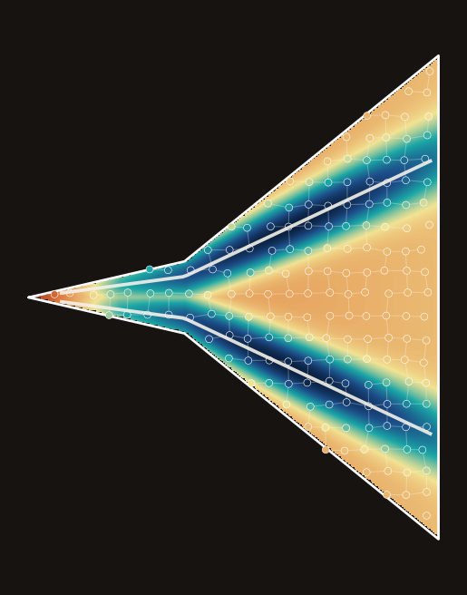

Conceptual design still has to trade the cost of CFD against the limits of a vortex lattice method. VortexNet is a graph neural network that learns corrections to low-fidelity panel loading using high-fidelity CFD, then predicts pressure-coefficient fields across delta-wing geometries and freestream conditions.

[Read the paper](https://arc.aiaa.org/doi/abs/10.2514/6.2025-0494) or the [slides](/files/Shen_Scitech_2025_VortexNet.pdf).
