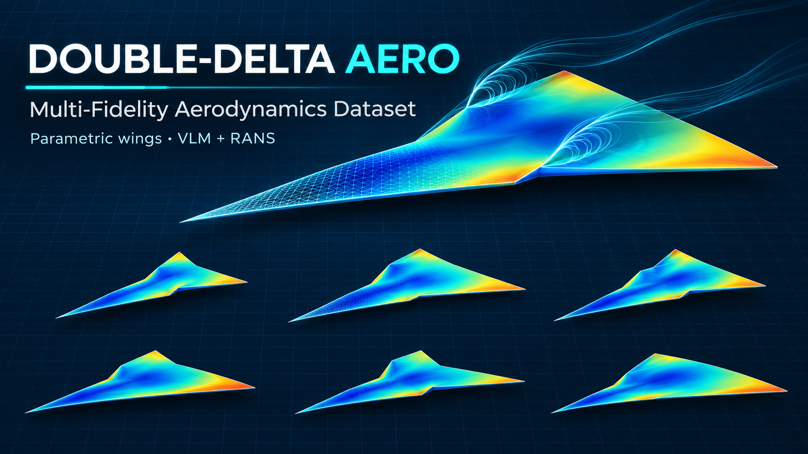

This SciTech paper releases a low-speed supersonic wing CFD dataset: 272 double-delta geometries and 2,448 flow snapshots, evaluated with both a vortex lattice method and RANS at low speed. A preliminary scaling study of MF-VortexNet finds that test error falls with dataset size as a power law.

[Read the paper](/files/Scitech_2026_VortexNetScaling.pdf).
