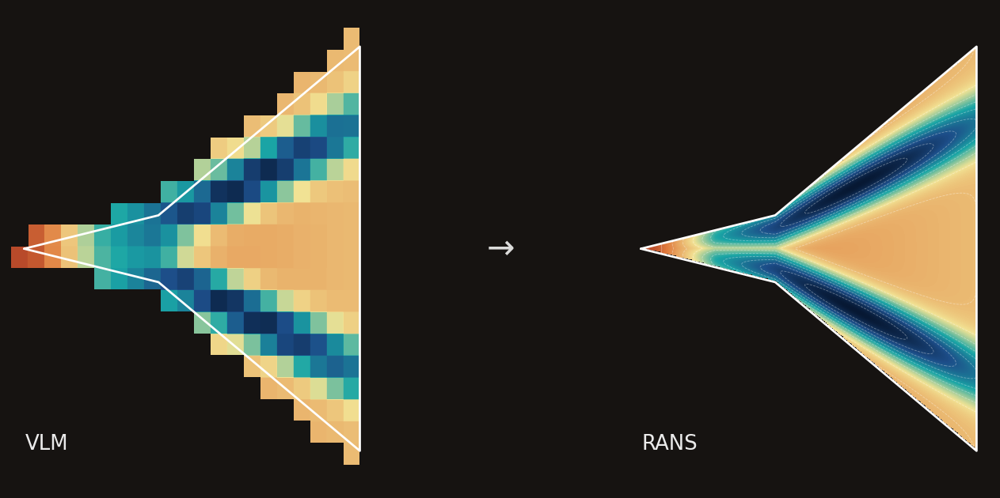

This note points to our Computers & Fluids paper on a multi-fidelity conceptual design workflow. The method uses a graph neural network field-prediction surrogate to augment low-fidelity aerodynamic analysis with high-fidelity CFD information, so early design studies can carry more of the flow physics that usually appears only in later analysis.

[Read the paper](https://doi.org/10.1016/j.compfluid.2026.107153) or the [local PDF](/files/Shen-et-al_2026_cnf.pdf).
